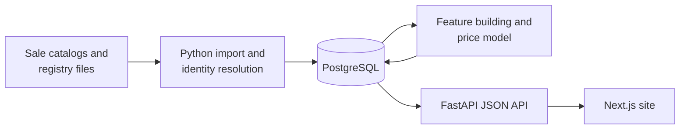

# CROSSR

Thoroughbred pedigree, stallion, mating and auction analytics. A **Next.js** site (`web/`) on a **FastAPI** JSON API (`crossr_api/`), backed by **PostgreSQL**, with the analysis in Python (pandas, NumPy, SciPy).

Sales still run on printed catalogs that are thousands of pages long. CROSSR puts the catalog, the pedigree, the female family, how similarly bred horses did at auction and on the track, and a price estimate on one page per horse.

> **About this repository.** CROSSR runs privately against a historical database that isn't included here. This public copy starts with fresh history: the private repository's history included data-collection code for sources I can't redistribute, so it isn't published. No data, trained models or credentials are in this repo.

<!-- DEMO: put the video link and 3–4 screenshots here, then remove this comment.
## Demo

[](VIDEO_URL)

| Stallion profile | Hypomating | Sale catalog |
|---|---|---|
|  |  |  |
-->

## What it does

- **Horse profiles:** a 5-generation pedigree, female family and produce record, race record, and sections that depend on the horse's type. Stallions get stud fee, mares bred, rankings, progeny statistics, top progeny, best broodmare-sire crosses and auction results. Mares get suggested stallions. Colts get similar active stallions.
- **Stallion directory:** filter by farm, crop, fee and stud year; compare stallions; star horses into a personal barn.
- **Hypomating:** given a broodmare, suggest stallions from graded-stakes-winning sire × damsire crosses (filtered by surface and fee). When the proven sire is too expensive, it offers his sons and other close relatives. Same-cross inbreeding is blocked.
- **Sales:** browse Keeneland and Fasig-Tipton catalogs, filter lots, see a sire's auction record or one horse's sale history, and get a price estimate for each lot.

## Technical highlights

| Area | What it does | Code |
|---|---|---|
| Entity resolution | Matches the same horse across sources using name, foaling year and sire; asks the user when a name is ambiguous; merges duplicate records without deleting them | [`crossr_core/identity.py`](crossr_core/identity.py), [`scripts/merge_duplicate_race_horses.py`](scripts/merge_duplicate_race_horses.py) |
| Pedigree algorithms | Recursive 5-generation traversal, inbreeding calculation | [`main.py`](main.py), [`crossr_core/pedigree_store.py`](crossr_core/pedigree_store.py) |
| Recommendation engine | Rule-based stallion ranking from historical graded-stakes crosses, with surface, fee and inbreeding constraints | [`hypomating_engine.py`](hypomating_engine.py) |
| Price model | Censored (Tobit) regression on log price: horses that failed to reach their reserve (RNAs) are kept as censored observations, meaning their value is below the recorded RNA price, instead of being dropped; tested on held-out sale years, rolling forward | [`crossr_core/sales_model.py`](crossr_core/sales_model.py), [`scripts/train_sales_model.py`](scripts/train_sales_model.py), [`docs/sales-model.md`](docs/sales-model.md) |
| Feature engineering | Sire, dam and family features rebuilt as of each sale year, so the model never sees later results | [`crossr_core/price_features.py`](crossr_core/price_features.py) |
| API and access control | FastAPI JSON API; the browser only receives JSON, and pages are hidden from anyone without an approved session | [`crossr_api/app.py`](crossr_api/app.py), [`crossr_core/access.py`](crossr_core/access.py) |

<!-- RESULTS: add once the metrics are re-run and verified, then remove this comment.
## Price model results

Held-out sale years, rolling forward (train on all earlier years, test on the next):

| Test year | Lots | Median abs. error (log price) | 80% interval coverage |
|---|---|---|---|
| … | … | … | … |
-->

## Architecture



## Layout

```
main.py                 Name cleaning, pedigree lookup, inbreeding
hypomating_engine.py    Mating suggestions from graded-stakes crosses
PriceProjection.py      Price projection for sale lots
ValueProjector.py       Breeding, racing and broodmare value
crossr_api/             FastAPI JSON API
crossr_core/            Profiles, identity, sales queries, price features and model, access control
crossr_pipeline/        Imports for sale and breeding files
web/                    Next.js UI
scripts/                Loaders, backfills, model training
db/schema.sql           Database schema
docs/                   Model write-ups
tests/                  Unit tests and an end-to-end API suite (tests/e2e)
```

## Running it

The app reads everything from PostgreSQL, so it needs a populated database, which isn't included. The unit tests don't need a database (136 pass, 2 skipped):

```bash
pip install -r requirements.txt
python3 -m pytest tests --ignore=tests/e2e
```

The end-to-end API suite in `tests/e2e` runs against a test database.

## How it was built

I designed CROSSR and built it between July and November 2026, using AI coding agents for much of the implementation.
