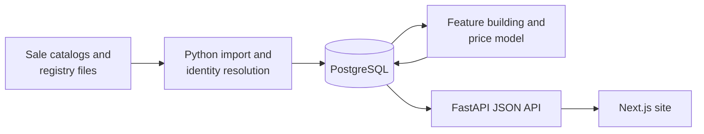

# CROSSR

Thoroughbred pedigree, stallion, mating and auction analytics. A **Next.js** site (`web/`) on a **FastAPI** JSON API (`crossr_api/`), backed by **PostgreSQL**, with the analysis and models in Python (pandas, NumPy, SciPy, LightGBM, scikit-learn).

Sales still run on printed catalogs that are thousands of pages long. CROSSR puts the catalog, the pedigree, the female family, how similarly bred horses did at auction and on the track, and a price estimate on one page per horse.

## Results at a glance

The models are in [`models_final/`](models_final/); the full write-up is [`models_final/SUMMARY.md`](models_final/SUMMARY.md). All scores are on sale years **2021–2025**, which were never used to fit or tune anything.

| Model | Result |
|---|---|
| **Auction sale price** (32,758 weanlings, yearlings and 2-year-olds) | R² **0.608** on log price (a first gradient-boosting model scored 0.406); typical miss ×1.79; 80% ranges hold **79.9%** of prices |
| **2-year-olds with breeze times** (OBS, 2025–2026) | R² 0.315 → **0.575** once the timed workout is added |
| **Mare breeding value** (1,659 foals) | The model's top fifth of mares sells foals for **×2.69** the bottom fifth's price-to-fee ratio; matings it recommends were profitable **68%** of the time vs 30% for the rest |
| **Stallion breeding value** (259 sires) | Ranking correlation (Spearman) **0.43** with lifetime AEI |
| **Pedigree vs the rest** | Pedigree alone explains about **41%** of price variation; sale placement (sale, hip, consignor) adds 17%; about **42%** is left for physical, vet and luck |
| **No-peeking tests** | 17 tests scramble every price a model shouldn't know yet and check that predictions don't move; they catch deliberately planted leaks |

**How the price model works:**
- Gradient-boosted trees (LightGBM), retrained before every sale year on all earlier years, with recent years weighted more.
- Horses that went unsold are kept as censored observations (their value was below the reserve), not dropped.
- Inputs are all known before the sale: catalog position, consignor, sire and dam records, the horse's earlier sale, and a forecast of this year's market move.
- Three corrections are learned from earlier data only: a bias shift, an update from the sale's earlier sessions, and an update from the sire's foals sold earlier that year. Each is shrunk toward zero when evidence is thin.
- Calibrated 80% ranges are widened by price tier and age, using the previous five years' misses.

> **About this repository.** CROSSR runs privately against a historical database that isn't included here. This public copy starts with fresh history: the private repository's history included data-collection code for sources I can't redistribute, so it isn't published. No data, trained models or credentials are in this repo, so the model scripts need the private data to run; the tests don't.

<!-- DEMO: put the video link and 3–4 screenshots here, then remove this comment.
## Demo

[](VIDEO_URL)

| Stallion profile | Hypomating | Sale catalog |
|---|---|---|
|  |  |  |
-->

## What it does

- **Horse profiles:** a 5-generation pedigree, female family and produce record, race record, and sections that depend on the horse's type. Stallions get stud fee, mares bred, rankings, progeny statistics, top progeny, best broodmare-sire crosses and auction results. Mares get suggested stallions. Colts get similar active stallions.
- **Stallion directory:** filter by farm, crop, fee and stud year; compare stallions; star horses into a personal barn.
- **Hypomating:** given a broodmare, suggest stallions from graded-stakes-winning sire × damsire crosses (filtered by surface and fee). When the proven sire is too expensive, it offers his sons and other close relatives. Same-cross inbreeding is blocked.
- **Sales:** browse Keeneland and Fasig-Tipton catalogs, filter lots, see a sire's auction record or one horse's sale history, and get a price estimate for each lot.

## Technical highlights

| Area | What it does | Code |
|---|---|---|
| Entity resolution | Matches the same horse across sources using name, foaling year and sire; asks the user when a name is ambiguous; merges duplicate records without deleting them | [`crossr_core/identity.py`](crossr_core/identity.py), [`scripts/merge_duplicate_race_horses.py`](scripts/merge_duplicate_race_horses.py) |
| Pedigree algorithms | Recursive 5-generation traversal, inbreeding calculation | [`main.py`](main.py), [`crossr_core/pedigree_store.py`](crossr_core/pedigree_store.py) |
| Recommendation engine | Rule-based stallion ranking from historical graded-stakes crosses, with surface, fee and inbreeding constraints | [`hypomating_engine.py`](hypomating_engine.py) |
| Final price model | Censored LightGBM retrained every year, with within-sale and sire updates and calibrated 80% ranges; R² 0.608 on 2021–2025 | [`models_final/rolling_price.py`](models_final/rolling_price.py), [`models_final/predict.py`](models_final/predict.py) |
| Leakage testing | Perturbation tests: scramble every later price, assert the prediction and range don't move, under six update settings | [`models_final/tests/test_leakage.py`](models_final/tests/test_leakage.py) |
| Breeze-time model | Workout time scored against horses that breezed the same distance on the same day | [`models_final/obs_2yo.py`](models_final/obs_2yo.py) |
| Breeding value | Linear models for stallion AEI and mare foal-price-to-fee, scored on ranking as well as R² | [`models_final/train_ebv.py`](models_final/train_ebv.py), [`models_final/ebv_ranking.py`](models_final/ebv_ranking.py) |
| App price model | Censored (Tobit) regression on log price used by the live app; unsold horses (RNAs) kept as censored observations | [`crossr_core/sales_model.py`](crossr_core/sales_model.py), [`docs/sales-model.md`](docs/sales-model.md) |
| Feature engineering | Sire, dam and family features rebuilt as of each sale year, so the model never sees later results | [`crossr_core/price_features.py`](crossr_core/price_features.py) |
| API and access control | FastAPI JSON API; the browser only receives JSON, and pages are hidden from anyone without an approved session | [`crossr_api/app.py`](crossr_api/app.py), [`crossr_core/access.py`](crossr_core/access.py) |

## Architecture



## Layout

```
main.py                 Name cleaning, pedigree lookup, inbreeding
hypomating_engine.py    Mating suggestions from graded-stakes crosses
PriceProjection.py      Price projection for sale lots
ValueProjector.py       Breeding, racing and broodmare value
crossr_api/             FastAPI JSON API
crossr_core/            Profiles, identity, sales queries, price features and model, access control
crossr_pipeline/        Imports for sale and breeding files
web/                    Next.js UI
scripts/                Loaders, backfills, model training
db/schema.sql           Database schema
models_final/           Final price, breeze-time and breeding-value models, leakage tests, SUMMARY.md
model_walkthrough/      Data loaders and baseline models the final ones build on
docs/                   Model write-ups
tests/                  Unit tests and an end-to-end API suite (tests/e2e)
```

## Running it

The app reads everything from PostgreSQL, so it needs a populated database, which isn't included. The unit tests don't need a database (136 pass, 2 skipped):

```bash
pip install -r requirements.txt
python3 -m pytest tests --ignore=tests/e2e
pip install -r requirements-model.txt
python3 -m pytest models_final/tests     # the 17 no-peeking tests, on synthetic data
```

The end-to-end API suite in `tests/e2e` runs against a test database.

## How it was built

I designed CROSSR and built it between July and November 2026, using AI coding agents for much of the implementation.
